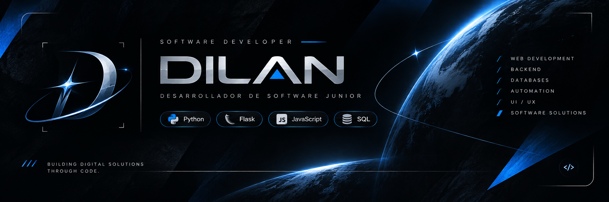

 

  

<h1 align="center">Hi, I'm Dilan 👋</h1>

<h3 align="center">
  Software Developer | Python | Flask | JavaScript
</h3>

  
  

  

---

## About Me

I'm a software developer in training from Bogotá, Colombia, passionate about technology, programming, and building digital solutions.

My main focus is web development, especially backend development with Python and Flask, relational databases, and creating functional, well-structured applications.

I enjoy turning ideas into real projects, exploring new technologies, and continuously improving my technical skills.

- 💻 Focused on **Full Stack Web Development**.
- 🐍 Developing applications with **Python and Flask**.
- 🗄️ Working with relational databases and SQLAlchemy.
- 🎨 Interested in modern UI/UX and responsive interfaces.
- ⚙️ Exploring automation and software architecture.
- 🔐 Interested in cybersecurity and secure application development.
- 🚀 Building real-world projects and expanding my portfolio.

---

## Tech Stack

**Languages**

  

**Backend & Frameworks**

  

**Tools & Development Environment**

  

**Additional Technologies**

- SQLAlchemy
- Flask-SQLAlchemy
- Flask-Migrate
- Alembic
- Jinja2
- Werkzeug
- SweetAlert2
- Cropper.js

**Currently Exploring**

- REST API development
- Software architecture and design patterns
- Automation and AI-powered workflows
- Cybersecurity fundamentals
- Advanced JavaScript

---

## Featured Projects

### 🌐 Personal Portfolio

My personal developer portfolio, designed to showcase my technical profile, projects, skills, and professional development.

**Focus:** Personal branding, responsive web design, and project presentation.

[Visit Portfolio](https://dilanwos.github.io/Portafolio/)

### ⚽ Football Tournament Management System

A web application developed with Flask to manage football tournaments and their related information.

**Key features:**
- Team management.
- Player management.
- CRUD operations.
- Image uploads.
- Database integration with SQLAlchemy.
- Modular application structure.
- Responsive user interface.
- Interactive confirmations with SweetAlert2.

[View Repository](https://github.com/Dilanwos/Sistema-Gestion-Torneos)

### 👥 User Management System

An authentication and user administration application developed with Flask.

**Key features:**
- User registration and authentication.
- Secure password hashing.
- Login and logout.
- Role-based access control.
- Administrator panel.
- Complete user CRUD.
- Session management.
- Protected routes.

[View Repository](https://github.com/Dilanwos/Sistema-usuarios-flask)

### 🎓 Student Management System

A Python project focused on student information management and backend programming fundamentals.

**Key features:**
- Student registration.
- Information management.
- CRUD operations.
- Data organization.
- Application logic.

[View Repository](https://github.com/Dilanwos/Sistema-gesti-n-estudiantes)

---

## Currently Building & Exploring

**KAEL — Clothing Brand & Digital Platform**

Developing a digital experience for a clothing brand focused on exclusivity, originality, innovation, and premium design.

Areas of interest:
- E-commerce development.
- Database architecture.
- Backend logic and application structure.
- User experience and visual identity.

**WebAstra — Digital Solutions**

Exploring the development of digital solutions for businesses, including:
- Website design and development.
- Custom software.
- Workflow automation.
- Website maintenance.

---

## Education & Continuous Learning

- **Universidad de La Sabana:** Technical training in software coding tools.
- **SENA:** Technical training in telematic systems.
- **SENA:** Cybersecurity concepts (48 hours).
- Continuous learning in Python, JavaScript, databases, software development, and cybersecurity.

---

## GitHub Analytics

  
  

  

---

## Let's Connect

  
  

  <i>Building, learning, and improving — one project at a time.</i>

  Thanks for visiting my GitHub profile! ⭐

